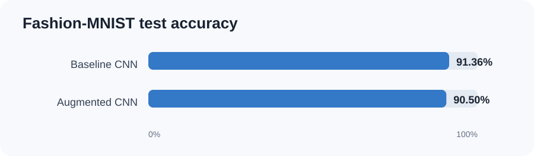

# CNN Image Classification

**Classify clothing images with Convolutional Neural Networks**

  

## Project overview

This project builds and evaluates CNN models to classify Fashion-MNIST images into **10 clothing categories**. It explores a baseline convolutional model and a second experiment using data augmentation, batch normalization and dropout.

## Results

| Experiment | Test accuracy |
|---|---:|
| Baseline CNN | **91.36%** |
| Augmented CNN | **90.50%** |

*Values are taken from the evaluation outputs recorded in the supplied notebook. The augmented experiment did not outperform the baseline in this run.*

## Workflow

1. Load Fashion-MNIST training and test images.
2. Normalize pixel values and reshape images for CNN input.
3. Train a convolutional neural network.
4. Plot training/validation accuracy and loss.
5. Evaluate the baseline model on the test set.
6. Experiment with augmentation, batch normalization and dropout; evaluate again.

## Model concepts

- Convolution and pooling for visual feature extraction
- ReLU activations and softmax classification
- Data augmentation and dropout as regularization experiments
- Training/validation curves and held-out test evaluation

## Run the project

Open [`cnn_image_classification.ipynb`](cnn_image_classification.ipynb) in Jupyter Notebook or Google Colab and run the cells in order. TensorFlow/Keras downloads Fashion-MNIST when needed.

## Repository files

- `cnn_image_classification.ipynb` — notebook and experiments
- `requirements.txt` — Python dependencies
- `assets/test-accuracy.svg` — test-result chart

## Notes

This is an educational image-classification project. Results can vary with random initialization, library versions and runtime environment.
